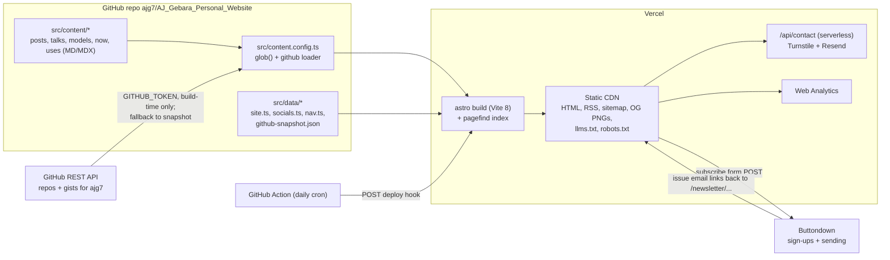

# PLAN.md: AJ Gebara personal website

This file is the source of truth for phases and milestones. Every milestone lists its pieces with an owner per sidekick mode (see CLAUDE.md). **AJ** pieces are learning-critical and written by AJ; Claude gives the file, signature, insertion point and concept only. **Claude** pieces are tests, fixtures, scaffolding, config, docs, or pieces AJ hands over with "you write this one".

Each phase gets a detailed plan in `docs/review/phase-N-plan.md`, written by the planner before any code.

Pace: about 5 hours a week. One milestone is about one week and ships on its own. MVP (Phases 1-3) lands after about 8 weeks. Phases 4-8 follow.

## Goal

A personal site for AJ Gebara, a working software engineer, built as a career asset. It serves three audiences, in priority order:

1. **Developer community.** Blog posts, gists, projects, talks, 3D work.
2. **Newsletter subscribers.** The newsletter archive on the site, with sign-up through Buttondown.
3. **Recruiters and hiring managers.** About page, resume PDF, projects, a contact form.

The homepage has to serve all three in that order: latest writing first, then a subscribe call to action, then a "hire / about / resume" strip.

Non-negotiables:
- Top-tier SEO and AI-search visibility: semantic HTML, crawlable text, JSON-LD (Person, ProfilePage, WebSite, BlogPosting), canonical URLs, sitemap, RSS, OG images, llms.txt, deliberate robots rules for AI crawlers, and one consistent author entity across profiles via `sameAs`.
- A terminal/hacker look that stays accessible: monospace, dark-first, prompt-style headings, normal crawlable navigation plus a Ctrl+K command palette, AA contrast in both themes, a light mode that follows `prefers-color-scheme`, reduced-motion support, and full keyboard support.
- Static-first. Ship JS only where interactivity needs it. No secrets in the client.

## Decisions

| Topic | Decision | Why |
|---|---|---|
| Framework | Astro 7 (7.4.x at planning time), TypeScript strict, static output | Content-first, zero JS by default, content collections. Astro 7 uses Vite 8 and the Rust compiler. |
| Node | Node 24 LTS, pinned with `.nvmrc` and `engines` | Astro 7.4 requires Node >= 22.23.4. AJ's machine has 22.17.0, so it **must be upgraded**. eslint-plugin-astro 3 also requires >= 22.22.3 / 24.16.0. |
| CSS | Tailwind CSS 4 through `@tailwindcss/vite`. Design tokens live in `@theme` in `src/styles/global.css`. | The current official Astro install path. Tokens stay in one place. |
| UI framework | None. Interactivity uses Astro components with bundled `<script>` (vanilla TS). | The only interactive pieces (theme toggle, command palette, search, 3D loader, form enhancement) are small. A framework runtime would add JS for nothing. |
| Fonts | Astro Fonts API, self-hosted. JetBrains Mono for headings, UI and code. A system sans stack for long-form prose. | Keeps the terminal look but stays readable for long posts. Only one webfont to download. |
| Theme | Follows `prefers-color-scheme` by default. A toggle overrides it with `data-theme` on `<html>`, set by a tiny inline head script (no flash), and Tailwind's `@custom-variant dark`. | Dark-first design, but light mode is real and honors the OS setting. |
| Content | Markdown/MDX in `src/content/` with content collections (`src/content.config.ts`, `glob()` loader, Zod from `astro/zod`). | AJ's choice. Typed frontmatter. |
| Blog vs newsletter | **One `posts` collection.** A post with a `newsletter: { issue }` frontmatter field is also a newsletter issue. `/blog` lists all posts, and `/newsletter` lists only the issues. The site is canonical. Buttondown sends the issue with a link back. | One source of content, no duplication, and the archive is crawlable on AJ's domain. |
| Newsletter sign-up | Plain HTML `<form method="post">` to Buttondown's `embed-subscribe/{username}` endpoint. No API key, and it works without JS. Buttondown does double opt-in. | Zero secrets and zero server code. |
| GitHub data | Custom content loader in `src/content.config.ts` that fetches repos and gists for **ajg7** at build time with `GITHUB_TOKEN` (server-only). If the fetch fails, it falls back to a committed snapshot in `src/data/github-snapshot.json`. | Content stays fresh, tokens stay out of the browser, and the build never breaks on API outages. |
| Scheduled rebuilds | A GitHub Actions `schedule` workflow POSTs a Vercel Deploy Hook (stored as an Actions secret) once a day. | Smallest moving part. A Vercel cron would need a serverless function just to call the hook. |
| URLs | `build.format: 'directory'` with Astro `trailingSlash: 'always'` and Vercel `trailingSlash: true`. Canonical URLs end in `/`. | Astro docs pair `directory` with `always`. Vercel 308-redirects `/about` to `/about/` and leaves files like `/rss.xml` alone, so there is exactly one URL per page. |
| Hosting | Vercel, static output. The `@astrojs/vercel` adapter is added **only** in Phase 6 for the contact endpoint (`prerender = false`). | Vercel needs no adapter for static sites. |
| Contact form | Astro endpoint `src/pages/api/contact.ts` (`prerender = false`). It validates with Zod, uses Cloudflare Turnstile plus a honeypot, and sends mail through Resend. Secrets come from `astro:env/server`. | Spam protection with no secrets on the client, and the rest of the site stays static. |
| Analytics | Vercel Web Analytics | Cookieless (visitors are identified by a hash that is discarded after 24 hours), so no cookie banner. Already on the host. |
| Search | Pagefind (static index built after `astro build`). It also feeds the command palette. | No server and no third party. It loads only when used. |
| Comments | Giscus (GitHub Discussions), opt-in per post, loaded only when the reader clicks. Phase 8. | The audience has GitHub accounts, and nothing loads until clicked. |
| RSS | `@astrojs/rss` at `/rss.xml` with full post content | Strongly expected by the developer audience. Also good for AEO. |
| OG images | Generated at build time per page, using satori + resvg in a static endpoint | Unique share cards with no runtime cost. |
| 3D models | **Renders first, interactive on request.** Each model page has a poster render (`astro:assets`, alt text, written description), an optional short turntable video, and a "View in 3D" button that loads `<model-viewer>` with the glTF only when clicked. | Images and text carry the SEO. The heavy 3D JS (about three.js size) never loads unless asked. |
| AI crawlers | Allow search and user-triggered agents (OAI-SearchBot, ChatGPT-User, Claude-SearchBot, Claude-User, PerplexityBot, Perplexity-User, Googlebot, Bingbot). Training crawlers (GPTBot, ClaudeBot, Google-Extended) are **allowed by default**, with the choice recorded in `src/data/site.ts`. | Being cited by AI is the goal for a career asset. Blocking Google-Extended does not affect Search ranking, so it is purely AJ's call. |

### Domain recommendation

**Buy `ajgebara.com` as the canonical domain** (an RDAP lookup on 2026-10-25 showed it unregistered; confirm at checkout). Optionally also buy `ajgebara.dev` and 308-redirect it to the .com.

- The exact name match is what entity consistency (the `sameAs` graph and the Person `@id`) and recruiters searching his name reward.
- `.com` is the most trusted and memorable TLD for the non-developer audiences (recruiters, newsletter readers). It also works for a future custom sending domain in Buttondown.
- `.dev` signals "developer" and is HSTS-preloaded (HTTPS only, which Vercel handles), but it reads as niche outside tech. Use it as a defensive redirect, not the canonical domain.
- `ajg.dev` is taken. `ajgebara.me` is free but weaker than .com.
- Registrar: Cloudflare Registrar, which charges at-cost renewals with no markup. Point DNS to Vercel with the A/CNAME values shown in Vercel's Domains settings, and set the records to **DNS only** (not proxied). Canonical host: the apex `https://ajgebara.com`, with `www` redirecting to it.

## Architecture

## Research findings

What strong personal sites do, and what this site takes from them:

- **Cassidy Williams (cassidoo.co).** Single column, playful bio, then a newsletter prompt right after the bio, a recent-posts list, and a second subscribe block (Buttondown plus RSS) below the posts. The site is open source. *Take:* ask for the subscribe twice (after the intro and after the posts), offer RSS next to email, and keep posts short-listed with dates and tags. She also uses Buttondown, which validates the choice.
- **DHH (dhh.dk, world.hey.com/dhh).** dhh.dk is a one-page "who I am" made of accomplishments with links out. The writing lives elsewhere, with "Subscribe to get future posts via email (or grab the RSS feed)" above the first post. *Take:* the About page is a scannable list of credentials. The subscribe line sits at the top of the archive and pairs email with RSS in one sentence.
- **Lee Robinson (leerob.com).** A short bio, then Notes, then dated Blogs. Text only, very minimal, and career context lives in the bio. *Take:* minimalism reads as confidence. Put the current role and history in two sentences on the homepage.
- **Brittany Chiang (brittanychiang.com).** Skip link, anchor nav (About / Experience / Projects), an experience timeline with tech tags, project cards with screenshots, and a "View Full Résumé" PDF link. Accessibility is part of the brand. *Take:* the recruiter strip and the About page get a timeline with tags and a resume PDF link, and accessibility is visible craft.
- **Maggie Appleton (maggieappleton.com).** A digital garden with typed content (essays, notes, patterns, talks), plus /now and a colophon. She curates a "Command K Bars" pattern. RSS only, no newsletter. *Take:* typed collections and a talks section with slides, video and transcript. A colophon in `/uses` fits.
- **Josh W. Comeau (joshwcomeau.com).** Category tiles, a "Popular content" list, and a newsletter form near the bottom ("Want to know when I publish new content?"). The footer has search, a dark mode toggle and RSS. *Take:* a "popular/start here" list for new visitors, and theme toggle plus search as utilities.
- **Paul Graham (paulgraham.com).** One long list of titles with three curated "start here" essays and RSS. *Take:* a curated "start here" entry point beats pagination for first-time visitors.
- **Will Sentance (willsentance.com).** "Missions" pillars, courses and talks as proof, an "Opportunities" mailto. *Take:* talks and videos are strong career proof, so they get their own collection.
- **ThePrimeagen.** I could not verify a current personal site (`theprimeagen.com` did not resolve on 2026-10-25). His presence is YouTube/Twitch first. *Take:* link out to video platforms through `sameAs` instead of mirroring them. **Unverified.**
- **/now convention (nownownow.com).** "What you'd tell a friend you hadn't seen in a year." Big picture, not a feed. Submit the URL to nownownow.com once it is live.

SEO / AI-search (AEO/GEO), current guidance:

- Google: there are "no additional requirements to appear in AI Overviews or AI Mode," and no special AI text files or schema are needed. Fundamentals win: crawlable text, internal links, indexing, Search Console. Structured data must match the visible text.
- So **llms.txt is a cheap bet, not a ranking lever.** Do it (Markdown, H1 plus blockquote plus H2 link lists, optional `.md` page versions linked via `<link rel="alternate" type="text/markdown">`), but invest first in semantic HTML and JSON-LD.
- ProfilePage requires `mainEntity` (Person with `name`). `sameAs`, `alternateName` (handle), `image`, `dateCreated` and `dateModified` are recommended. Do not use a placeholder image.
- BlogPosting: `author` as a `Person` with `url` or `sameAs`, plus `headline`, `image` (16x9, 4x3 and 1x1 ideally), and ISO 8601 `datePublished`/`dateModified`.
- AI crawlers have separate tokens for search, training and user-triggered fetching (OpenAI: OAI-SearchBot / GPTBot / ChatGPT-User; Anthropic: Claude-SearchBot / ClaudeBot / Claude-User; Perplexity: PerplexityBot / Perplexity-User; Google: Google-Extended is a control token only and does not affect Search).

## Phases

Owner legend: **AJ** writes it. **Claude** writes it. **AJ (ops)** is an account or dashboard action only AJ can do.

### Phase 1: Foundation (weeks 1-3)

**Milestone 1.1: Scaffold and tooling**
Outcome: an Astro 7 + TS strict + Tailwind 4 project that runs, with every npm script from CLAUDE.md working and CI green on a placeholder homepage.
- **AJ (ops):** install Node 24 LTS (current 22.17.0 is below Astro's minimum).
- **Claude:** `package.json` with scripts `dev`, `build`, `preview`, `check`, `lint`, `test`, `e2e`; `engines`, `.nvmrc`; `astro.config.mjs` (`site`, Tailwind Vite plugin); `tsconfig.json` (Astro strict); `src/styles/global.css` with `@import "tailwindcss"` only; placeholder `src/pages/index.astro`; ESLint flat config (eslint-plugin-astro + typescript-eslint + jsx-a11y); Vitest (`getViteConfig`) with one harness test; Playwright against the built site with an axe smoke test; `.gitignore`; GitHub Actions CI running all five checks; README dev section.
- **AJ:** read through `astro.config.mjs`, `tsconfig.json` and the build output with the walkthrough in `docs/review/phase-1-plan.md`. No code to write here.

**Milestone 1.2: Design tokens and layout shell**
Outcome: every page shares a semantic layout with header, nav, main and footer, a skip link, terminal styling, and a light/dark theme that follows the OS and can be toggled without a flash.
- **AJ:** design tokens in `@theme` plus the `dark` custom variant in `src/styles/global.css`; `src/layouts/BaseLayout.astro`; `src/components/SiteHeader.astro` (crawlable nav with `aria-current`); `src/components/ThemeToggle.astro` (inline pre-paint script plus toggle button); `src/components/PromptHeading.astro` (prompt-style heading with a decorative prefix).
- **Claude:** Fonts API config (JetBrains Mono); `src/data/site.ts` (name, URL, description, locale, crawler policy); `src/data/socials.ts` (typed list for all eight profiles, used later for footer, `rel="me"` and `sameAs`); `src/data/nav.ts`; `src/components/SiteFooter.astro` (reads socials); `src/pages/404.astro`; favicon; e2e tests for landmarks, skip link, theme toggle, keyboard focus, axe in both themes, 375px and desktop.

**Milestone 1.3: Head/SEO base, identity data, first deploy**
Outcome: every page has a correct title, description, canonical, OG and Twitter meta. `robots.txt` and the sitemap are live. The site is deployed on Vercel at `https://ajgebara.com`.
- **AJ:** `src/components/Seo.astro` (head meta from props); `src/pages/robots.txt.ts` (static endpoint with AI-crawler groups and the sitemap URL).
- **AJ (ops):** buy `ajgebara.com` (plus optional `ajgebara.dev`) at Cloudflare Registrar; create the Vercel project from the GitHub repo; add the domains; set DNS records (DNS only); redirect `www` to the apex; verify in Google Search Console and Bing Webmaster Tools.
- **Claude:** `@astrojs/sitemap` config; `vercel.json` (`trailingSlash: true`); `docs/deploy.md` runbook; tests for meta tags, robots and sitemap.

### Phase 2: Content core (weeks 4-6)

**Milestone 2.1: Posts collection, blog routes, RSS**
Outcome: AJ writes a `.md`/`.mdx` file and it appears at `/blog/<slug>`, in `/blog`, in `/blog/tags/<tag>` and in `/rss.xml`. Drafts never ship.
- **AJ:** `posts` collection schema in `src/content.config.ts` (title, description, pubDate, updatedDate, tags, draft, heroImage via `image()`, `newsletter?: { issue }`); `src/pages/blog/[...slug].astro` with `getStaticPaths` and `render()`; `src/layouts/PostLayout.astro` (article semantics, reading typography).
- **Claude:** `@astrojs/mdx`; `src/lib/posts.ts` helpers (sort, filter drafts, tag index) with unit tests; `src/pages/blog/index.astro`, tag pages; `src/pages/rss.xml.ts`; two fixture posts; e2e tests.

**Milestone 2.2: Home, About, resume, /now, /uses**
Outcome: the homepage serves all three audiences (latest posts, subscribe placeholder slot, about/resume strip). About has the timeline and a resume PDF. /now and /uses come from content.
- **AJ:** `src/pages/index.astro` layout and copy; `src/components/Timeline.astro` (semantic `<ol>` experience timeline); About page copy.
- **Claude:** `experience` data collection (`file()` loader) and schema; singleton collections or pages for `now` and `uses`; `public/resume.pdf` link handling (AJ supplies the PDF); e2e tests.

**Milestone 2.3: Structured data and AI-readability**
Outcome: valid JSON-LD on every page type, `/llms.txt` and `.md` alternates for posts, and one author entity shared across all of them.
- **AJ:** `src/lib/jsonld.ts` builders (`personNode`, `websiteNode`, `profilePageNode`, `blogPostingNode`) that share one Person `@id` and `sameAs` from `socials.ts`; `src/components/JsonLd.astro` (safe serialization); `src/pages/llms.txt.ts`.
- **Claude:** `src/pages/blog/[...slug].md.ts` Markdown alternates; unit tests for the builders (shape, ISO dates, `@id` consistency); e2e tests that parse JSON-LD on each page type; checklist for Google's Rich Results Test in `docs/deploy.md`.

### Phase 3: Newsletter and launch (weeks 7-8) -> MVP

**Milestone 3.1: Buttondown sign-up and newsletter archive**
Outcome: a visitor can subscribe from the homepage, from post footers and from `/newsletter`, with or without JS. `/newsletter` lists issues, and each issue's page is the canonical web version.
- **AJ:** `src/components/SubscribeForm.astro` (labelled email field, POST to Buttondown embed endpoint, optional progressive enhancement with inline success/error and `aria-live`); `src/pages/newsletter/index.astro`.
- **AJ (ops):** create the Buttondown account and username; set the post-confirmation redirect to `https://ajgebara.com/newsletter/thanks`.
- **Claude:** `src/pages/newsletter/thanks.astro`; newsletter filter helper plus tests; `docs/newsletter.md` (publishing workflow: write post with `newsletter.issue`, deploy, send from Buttondown with the canonical link); e2e tests (form attributes, label, no-JS submit target).

**Milestone 3.2: OG images, analytics, launch**
Outcome: each page shares with a unique card. Analytics is on. Lighthouse is 95+ on all categories for home and a post. The site is announced.
- **AJ:** OG card template (`src/lib/og.ts`, satori markup plus resvg render) and the `src/pages/og/[...slug].png.ts` endpoint.
- **Claude:** wire `image` into `Seo.astro` call sites; Vercel Web Analytics; launch checklist in `docs/deploy.md` (Search Console sitemap submit, nownownow.com, profile links pointing back, `rel="me"` on Mastodon); e2e test that every page's `og:image` returns 200.

### Phase 4: GitHub data (weeks 9-11)

**Milestone 4.1: GitHub loader and projects showcase**
Outcome: `/projects` shows curated projects (MDX) enriched with live repo stats from the GitHub API at build time. A failed API call falls back to the snapshot and logs a warning, and the build still passes.
- **AJ:** the custom loader `githubRepos()` in `src/lib/github/loader.ts` (Content Loader API: fetch, paginate, map to schema, `store.set`, fallback); `src/pages/projects/index.astro`.
- **Claude:** `GITHUB_TOKEN` via `astro:env` (server, secret, optional); `scripts/github-snapshot.ts` and `npm run github:snapshot`; `src/data/github-snapshot.json`; `projects` MDX collection; unit tests with fixtures for success, 403 rate limit, 5xx, and missing token.

**Milestone 4.2: Gists**
Outcome: `/gists` lists public gists, and `/gists/<id>` shows each one's files with syntax highlighting.
- **AJ:** `githubGists()` loader (list, then fetch each gist for file content; respect `truncated`); `src/pages/gists/[id].astro`.
- **Claude:** schema, list page, fixtures, tests.

**Milestone 4.3: Scheduled rebuilds**
Outcome: the site rebuilds daily with fresh GitHub data, and the deploy hook URL is never in the repo.
- **AJ (ops):** create the Vercel Deploy Hook; add it as the `VERCEL_DEPLOY_HOOK` Actions secret; add `GITHUB_TOKEN` (fine-grained, public read-only) to Vercel env vars.
- **Claude:** `.github/workflows/rebuild.yml` (`schedule` at an off-peak minute plus `workflow_dispatch`); `docs/deploy.md` note on the 60-day inactivity auto-disable for public repos.

### Phase 5: Search and command palette (weeks 12-13)

**Milestone 5.1: Pagefind search**
Outcome: `/search` works with keyboard and screen readers, and the index builds in `npm run build`.
- **AJ:** `src/pages/search.astro` UI (lazy-loads Pagefind on focus).
- **Claude:** Pagefind build integration, `data-pagefind-body` placement, e2e tests.

**Milestone 5.2: Ctrl+K command palette**
Outcome: Ctrl+K / Cmd+K (and a visible header button) opens a dialog with nav commands, theme toggle and search results. It is a progressive enhancement over the normal nav.
- **AJ:** `src/components/CommandPalette.astro` with its `<script>` (native `<dialog>`, focus trap via `showModal`, combobox/listbox ARIA, arrow-key navigation, reduced-motion aware).
- **Claude:** commands data from `nav.ts`; e2e tests for keyboard flows and axe.

### Phase 6: Contact (week 14)

**Milestone 6.1: Contact form**
Outcome: `/contact` sends AJ an email. Bots are rejected server-side. No secrets reach the client.
- **AJ:** `src/pages/api/contact.ts` (`prerender = false`, Zod validation, honeypot, Turnstile siteverify, Resend send, redirect back with status); `src/pages/contact.astro` form.
- **AJ (ops):** Turnstile site plus keys; Resend account plus verified sending domain on ajgebara.com.
- **Claude:** `@astrojs/vercel` adapter; `astro:env` schema (`TURNSTILE_SECRET_KEY`, `RESEND_API_KEY` server secret; `PUBLIC_TURNSTILE_SITE_KEY` public); unit tests for validation; e2e tests for form a11y and an error path with a mocked endpoint.

### Phase 7: Talks and 3D models (weeks 15-17)

**Milestone 7.1: Talks**
- **AJ:** `talks` schema (event, date, slides URL, video URL, transcript in body) and `/talks` page.
- **Claude:** detail route, `VideoObject`/`Event` JSON-LD tests, fixtures.

**Milestone 7.2: 3D models gallery (renders)**
- **AJ:** `models` schema (title, description, poster via `image()`, alt, optional turntable video, glb path, polycount, tools); `/models` grid and detail page with `<Picture>`.
- **Claude:** turntable `<video>` handling (muted, `playsinline`, poster, paused and controls-only under reduced motion); fixtures; e2e tests.

**Milestone 7.3: On-demand 3D viewer**
- **AJ:** `src/components/ModelViewer.astro`, where a "View in 3D" button dynamically imports `@google/model-viewer` and swaps in the element (`camera-controls`, `alt`, `poster`).
- **Claude:** asset pipeline note for glTF/Draco export from Blender in `docs/models.md`; e2e test that no model-viewer JS loads before the click.

### Phase 8: Community and polish (week 18+)

**Milestone 8.1: Giscus comments** (opt-in per post, click to load)
- **AJ:** `src/components/Comments.astro`. **Claude:** frontmatter flag, CSP/iframe notes, tests.

**Milestone 8.2: Cross-posting to dev.to and Hashnode** with `canonical_url` pointing to the site
- **Claude:** `docs/crossposting.md` and a script that emits ready-to-paste frontmatter. **AJ:** decide per post.

**Milestone 8.3: Performance and accessibility budgets in CI**
- **Claude:** Lighthouse CI (or an equivalent) on home, a post, `/projects` and `/models`, with fail thresholds.

## Open questions for AJ

1. Confirm `ajgebara.com` (plus optional `ajgebara.dev` redirect) before Milestone 1.3.
2. AI training crawlers (GPTBot, ClaudeBot, Google-Extended): allow (default) or block? Search and user-triggered agents stay allowed either way.
3. Exact handles/URLs for GitHub (ajg7), LinkedIn, X, Bluesky, YouTube, Mastodon (instance), dev.to and Hashnode.
4. Preferred Buttondown username (it appears in the form endpoint and the email sender).
5. Body prose font: system sans (recommended) or monospace everywhere?
6. Which repos count as "projects" (curated list) vs everything in `/gists`?
7. The headshot photo and resume PDF to use (needed in Phase 2).

## Sources

- Astro install/Node requirement: https://docs.astro.build/en/install-and-setup/ ; npm registry `astro@7.4.2` engines `node >=22.23.4` (checked 2026-10-25)
- Astro v7 upgrade (Vite 8, Rust compiler, `compressHTML: 'jsx'`, Sätteri Markdown): https://docs.astro.build/en/guides/upgrade-to/v7/
- Astro v6 upgrade (Content Layer only): https://docs.astro.build/en/guides/upgrade-to/v6/
- Content collections: https://docs.astro.build/en/guides/content-collections/
- Fonts API: https://docs.astro.build/en/guides/fonts/
- On-demand rendering: https://docs.astro.build/en/guides/on-demand-rendering/
- Actions: https://docs.astro.build/en/guides/actions/
- Env vars / `astro:env`: https://docs.astro.build/en/guides/environment-variables/
- View transitions / reduced motion: https://docs.astro.build/en/guides/view-transitions/
- Sitemap: https://docs.astro.build/en/guides/integrations-guide/sitemap/
- Vercel adapter: https://docs.astro.build/en/guides/integrations-guide/vercel/
- Testing (Vitest `getViteConfig`, Playwright `webServer`): https://docs.astro.build/en/guides/testing/
- Tailwind + Astro: https://tailwindcss.com/docs/installation/framework-guides/astro
- Tailwind dark mode: https://tailwindcss.com/docs/dark-mode
- eslint-plugin-astro: https://ota-meshi.github.io/eslint-plugin-astro/user-guide/
- Vercel deploy hooks: https://vercel.com/docs/deploy-hooks
- Vercel domains: https://vercel.com/docs/domains/working-with-domains/add-a-domain
- Vercel Web Analytics privacy: https://vercel.com/docs/analytics/privacy-policy
- Cloudflare Registrar: https://www.cloudflare.com/products/registrar/
- Cloudflare Turnstile: https://developers.cloudflare.com/turnstile/get-started/
- GitHub REST rate limits: https://docs.github.com/en/rest/using-the-rest-api/rate-limits-for-the-rest-api
- GitHub gists API: https://docs.github.com/en/rest/gists/gists#list-gists-for-a-user
- GitHub Actions schedule: https://docs.github.com/en/actions/reference/workflows-and-actions/events-that-trigger-workflows#schedule
- Buttondown embed form: https://buttondown.com/features/integrations/webflow , https://docs.buttondown.com/building-your-subscriber-base
- Google AI features: https://developers.google.com/search/docs/appearance/ai-features
- Google ProfilePage: https://developers.google.com/search/docs/appearance/structured-data/profile-page
- Google Article/BlogPosting: https://developers.google.com/search/docs/appearance/structured-data/article
- Google-Extended: https://developers.google.com/search/docs/crawling-indexing/google-common-crawlers
- OpenAI crawlers: https://developers.openai.com/api/docs/bots
- Anthropic crawlers: https://support.claude.com/en/articles/8896518-does-anthropic-crawl-data-from-the-web
- Perplexity crawlers: https://docs.perplexity.ai/guides/bots
- llms.txt: https://llmstxt.org/
- /now: https://nownownow.com/about
- Sites studied: https://cassidoo.co/ , https://dhh.dk/ , https://world.hey.com/dhh , https://leerob.com/ , https://brittanychiang.com/ , https://maggieappleton.com/ , https://www.joshwcomeau.com/ , https://paulgraham.com/articles.html , https://willsentance.com/
